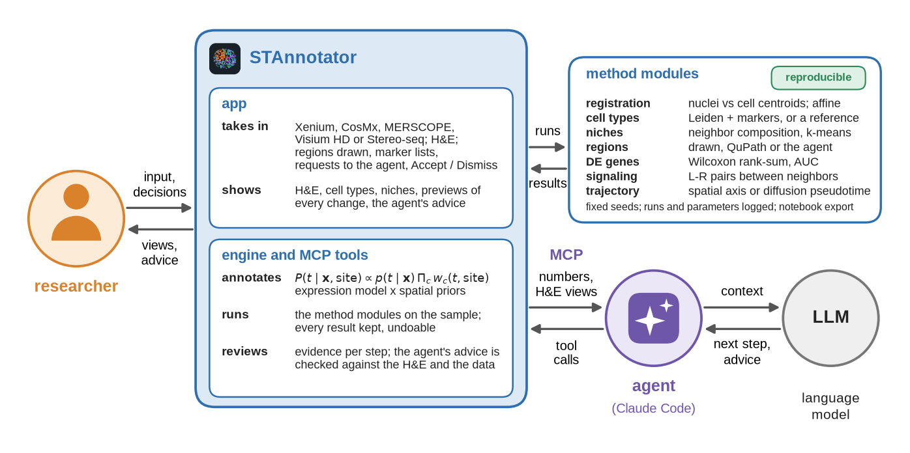

<p align="center">
  
</p>

<h1 align="center">STAnnotator</h1>

<p align="center">
  <a href="https://github.com/caokai1073/STAnnotator/releases/latest">Download for macOS and Windows</a> ·
  <a href="docs/GUIDE.md">User guide</a> ·
  <a href="https://www.caokai.site/STAnnotator/">Website</a>
</p>

Spatial transcriptomics (Xenium, Atera, CosMx, MERSCOPE, Visium HD, Stereo-seq, …) on the tissue image, from registration
and cell types to regions, niches, composition and DE genes, cell-cell communication, trajectories and pseudotime,
and comparisons across regions, slices and conditions, with an AI agent at your side.

<p align="center">
  
</p>

- **Annotate** from a marker gene list, a labeled single-cell reference, or an existing annotation.
- **Refine in plain language**: priors ("epithelial cells are only in the mucosa"), corrections, re-clustering.
  Every change is a version you can undo.
- **Analyze**: regions you draw (with QuPath-like tools: brush, pen, polygon, rectangle, ellipse), PCA / UMAP / Leiden, niches, DE genes, composition, cell-cell communication; one
  slice or several slices together.
- **Review**: the agent reviews one part of the analysis, checks its own advice against the data, and keeps
  only what holds up.

The agent is your own [Claude Code](https://code.claude.com/docs/en/setup), with your own Claude account: a Claude plan
that includes Claude Code (Pro or higher; the free plan does not). Setting it up, step by step:
[docs/CLAUDE_CODE.md](docs/CLAUDE_CODE.md).
Your images and expression data stay on your computer (or your server).

Three ways to run it:

| | Data and computation | Window and agent |
|---|---|---|
| [A. Local computer](#a-local-computer) | your computer | your computer |
| [B. Remote server over SSH](#b-remote-server-over-ssh) | the server | your computer |
| [C. Many samples in a terminal](#c-many-samples-in-a-terminal-batch) | a server or cluster | none: it decides by itself; review flagged samples with A or B |

## A. Local computer

**You need**
- A Mac with Apple silicon (macOS 14+) or a PC with Windows 10 / 11 (x64), and 8 GB of RAM or more. Linux: install
  from source.
- Claude Code, installed and logged in once (`claude` works in Terminal, or in PowerShell on Windows):
  [step by step](docs/CLAUDE_CODE.md).

**Install the app on a Mac**

Download `STAnnotator.dmg` (Apple silicon) or `STAnnotator_Intel.dmg` (Intel Macs) from the
[latest release](https://github.com/caokai1073/STAnnotator/releases/latest), open it and drag **STAnnotator** to
Applications. It contains everything; no Python needed. (Apple menu > About This Mac: a "Chip" line means Apple
silicon, a "Processor" line with Intel means Intel.) The app updates itself with the file for its Mac.

**Install the app on Windows**

Download `STAnnotator-Setup.exe` from the [latest release](https://github.com/caokai1073/STAnnotator/releases/latest)
and run it. It contains everything; no Python needed.
- Choose where to install (any drive; for your user without administrator rights, or for all users) and, the first
  time, where to keep the data (samples and annotations; **Change data folder** in About moves it later).
- The installer is not signed yet: if Windows SmartScreen stops it, click **More info → Run anyway**.
- Start **STAnnotator** from the Start menu or the desktop shortcut. **Agent** opens Claude Code in its own
  console window.
- Uninstalling removes the program only; the data and the settings stay.

**Or install from source** (Linux, developers):

```bash
git clone https://github.com/caokai1073/STAnnotator.git && cd STAnnotator
uv venv .venv --python 3.12 && uv pip install --python .venv/bin/python -e ".[app]"
.venv/bin/stagent app            # the window; --browser for a browser tab
```

**Settings**: none. Data and annotations go to `~/stagent`, or the folder chosen in the Windows installer or with
**Change data folder** in About (`STAGENT_HOME` overrides both).

## B. Remote server over SSH

Data and computation stay on the server; your computer shows the window and runs Claude Code. Nothing is copied
to your computer except what you export.

**On the server** (Linux or macOS; no window, no root):

```bash
curl -LsSf https://astral.sh/uv/install.sh | sh && source $HOME/.local/bin/env
git clone https://github.com/caokai1073/STAnnotator.git ~/STAnnotator && cd ~/STAnnotator
uv venv .venv --python 3.12 && uv pip install --python .venv/bin/python -e .
```

Use the same version as the app on your computer. Data goes to `~/stagent` on the server unless you choose another
folder when connecting.

**On your computer**
- The app (section A) and Claude Code, logged in.
- SSH login to the server **without a password prompt** (the app cannot type one):
  ```bash
  ssh-keygen -t ed25519            # once, if you have no key
  ssh-copy-id user@server          # then `ssh user@server` must log in directly
  ```
  On Windows (PowerShell; the OpenSSH client is part of Windows 10 / 11), instead of `ssh-copy-id`:
  ```powershell
  type $env:USERPROFILE\.ssh\id_ed25519.pub | ssh user@server "mkdir -p ~/.ssh && cat >> ~/.ssh/authorized_keys"
  ```
- Optional: a `Host` entry in `~/.ssh/config` (Windows: `%USERPROFILE%\.ssh\config`; user, port, jump host); the app
  uses it.

**Connect**: in the app click **Local** (right panel, beside **Export**) → **A server over SSH**, and enter
1. the server (`user@server` or a `Host` of `~/.ssh/config`),
2. the command on the server: `~/STAnnotator/.venv/bin/stagent`,
3. optionally the data folder on the server,

then **Test** and **Connect**. The app reconnects by itself at the next start; **Use this computer** switches back.

While connected, **Choose…** browses the server's files, **Export** and **Save** download to your computer, and
**Agent** opens Claude Code here with its tools running on the server. No port is opened on the server: the
window reaches it through an SSH tunnel.

After updating STAnnotator on the server, reconnect once so that the server's viewer restarts with the new version.

## C. Many samples in a terminal (batch)

For tens to thousands of sections, `stagent batch` imports, registers and annotates every sample of a list in a
server's terminal, without the app or the agent, and writes CSV files. Where the app would ask you, it decides by
itself (auto mode, the default) and flags what it could not settle.

Install as on the server in section B. Then write a manifest, one row per sample:

```csv
sample,xenium,he,registration,organ
s001,/data/run1/output-XETG...-s001,/data/he/s001.ome.tif,/data/he/s001_imagealignment.csv,colon
s002,/data/run1/output-XETG...-s002,/data/he/s002.ome.tif,,colon
s003,/data/run2/output-XETG...-s003,,,colon
```

- `xenium`: a Xenium or Atera output folder (a folder of several slices: one row per slice, its name prefix in `section`), or
  `h5ad` (with `section_column` / `section` for an h5ad of several sections).
- `he`, `registration`: optional. Without an alignment file the app's alignment search runs, the best candidates are
  checked against the nuclei over the whole tissue and the best is applied (never one that is far off); where the
  tissue is shifted locally (stretched or torn), the local correction is applied when it brings the cells closer to
  their nuclei.
- `organ` (a built-in marker list, pruned to the panel) or `markers` (your own list file). No agent runs: refine the
  list on a few samples in the app first, then give it to the batch.

```bash
~/STAnnotator/.venv/bin/stagent batch manifest.csv --out /scratch/batch1 --jobs 4
# on a cluster, one array job per shard (e.g. Slurm with 50 jobs):
~/STAnnotator/.venv/bin/stagent batch manifest.csv --out /scratch/batch1 --shard $SLURM_ARRAY_TASK_ID/50
```

In `--out`:
- `results/<sample>/annotation.csv` (one row per cell: cell type, lineage, confidence, `x_um`, `y_um`),
  `cell_positions.csv` (with `px`, `py` on the H&E when the cells were placed on it), `registration.csv`,
  `types_not_found.csv` (the list's types without cells, and why), `qc.json`;
- `summary.csv`: one row per sample with its status (`ok`, `flagged`, `failed`), the reason of a flag (e.g. no
  alignment found, another orientation fits too), the registration check and the share of Unassigned cells;
- `data/`: the batch's data folder. Open flagged samples in the app over SSH (section B) with this folder as the data
  folder.

Run the same command again after a stop: steps already done with the same inputs are kept, and a sample that fails
never stops the others. Each job needs the memory of one annotation (about 11 GB for 800,000 cells). Options
(`--no-auto`, `--drop-data`, `--knn approx` on a server without a GPU, ...): `stagent batch --help` and the
[user guide](docs/GUIDE.md#many-samples-at-once-batch-without-the-app).

## Getting started

1. **Import**: Xenium (`cells.parquet` and `cell_feature_matrix.h5`; optionally `experiment.xenium` and the DAPI
   image), 10x Atera (`cell_feature_matrix.zarr.zip`, or the output folder), or h5ad / RDS (Seurat, SpatialExperiment; read without R). Optionally the H&E and its registration;
   without a registration, **Align with Agent** aligns the H&E for you.
2. **Type** tab: a marker list (**Markers…**: import a CSV, or **Start from an organ**: a built-in list for
   12 common organs pruned to your gene panel, which the agent can complete) or a reference, then **Annotate**.
3. Draw regions on the map; ask the agent with **Agent**, e.g. "epithelial cells are only in the mucosa".
4. **Embed**, **Niche**, **Compare**, **Signal** and **Trajectory** (spatial axes, pseudotime) tabs for the
   analyses; **Review** for a second opinion; **Export** for the cell table, the registration, the regions
   (GeoJSON) or a Jupyter notebook that reproduces the analysis.

An **H&E only** import lets a pathologist draw and name regions before the expression data exist; they go to the
data imported later on the same image.

Example data and marker lists: `examples/` (SCP2927 IBD Xenium atlas, Cadinu et al. MERFISH mouse colon).
Every control and method is described in the [user guide](docs/GUIDE.md).

## Command line

```bash
stagent import-xenium --name s1 --xenium cells.parquet cell_feature_matrix.h5 [--he he.ome.tif --registration reg.csv]
stagent import --name s1 --h5ad cells.h5ad [--he he.ome.tif --registration reg.csv --section-column donor --section 147328]
stagent batch manifest.csv --out DIR [--jobs 4]   # many samples without the app (section C)
stagent viewer              # the viewer in a browser, http://localhost:8765
stagent mcp                 # the agent's tools, for Claude Code without the app
```

## Troubleshooting

- **Something went wrong**: the bug icon (top right, between **?** and **›**): describe the bug, add up to 3 screenshots if
  they help, and the app adds your conversations with the agent, its tool calls, the analyses you ran (settings and
  time taken, not results) and the app's log (no expression data).
  Upload it to the developers in one click, or save it and send it.
- **The app does not open**: see `~/Library/Caches/STAnnotator/app.log` (Windows: `%LOCALAPPDATA%\STAnnotator\app.log`;
  from source: `~/stagent/app.log`), or run
  `stagent app` in Terminal to see the error.
- **Agent does nothing**: Claude Code must be installed and logged in (`claude` works in Terminal or PowerShell).
- **Server: Test fails**: `ssh user@server` must log in without a password, and the command path must be right
  (`ssh user@server ~/STAnnotator/.venv/bin/stagent remote-serve --check` prints JSON).
- **Few cells on the H&E**: check the registration file and that cell coordinates are in micrometers.

## Contributing

Bug reports, ideas and pull requests are welcome: see [CONTRIBUTING.md](CONTRIBUTING.md) for setting up the source
and running the tests.

## Citation

If you use STAnnotator in published work, please cite it (the paper reference will be added here):
STAnnotator, https://github.com/caokai1073/STAnnotator, and the version you used.

## License

[PolyForm Noncommercial 1.0.0](LICENSE): free for research, teaching and other noncommercial use, including the source
code; for commercial use, contact us by email at [cao@broadinstitute.org](mailto:cao@broadinstitute.org).
Versions up to 0.2.42 remain under Apache 2.0.
