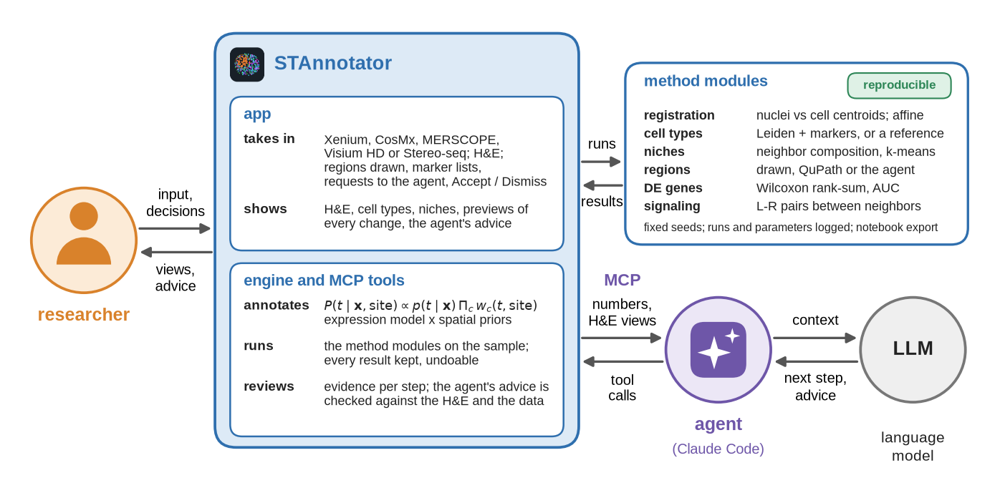

  

<h1 align="center">STAnnotator</h1>

  <a href="https://github.com/caokai1073/STAnnotator/releases/latest">Download for macOS and Windows</a> ·
  <a href="docs/GUIDE.md">User guide</a> ·
  <a href="https://caokai1073.github.io/STAnnotator/">Website</a>

Spatial transcriptomics (Xenium, CosMx, MERSCOPE, Visium HD, Stereo-seq, …) on the tissue image, from registration
and cell types to regions, niches, cell-cell communication and comparisons across slices, with an AI agent at your
side.

  

- **Annotate** from a marker gene list, a labeled single-cell reference, or an existing annotation.
- **Refine in plain language**: priors ("epithelial cells are only in the mucosa"), corrections, re-clustering.
  Every change is a version you can undo.
- **Analyze**: regions you draw, PCA / UMAP / Leiden, niches, DE genes, composition, cell-cell communication; one
  slice or several slices together.
- **Agent Review**: the agent reviews one part of the analysis, checks its own advice against the data, and keeps
  only what holds up.

The agent is your own [Claude Code](https://docs.claude.com/en/docs/claude-code/setup), with your own Claude account.
Your images and expression data stay on your computer (or your server).

## Install

**You need**
- A Mac with Apple silicon (macOS 11+) or a PC with Windows 10 / 11 (x64), and 8 GB of RAM or more.
- Claude Code, installed and logged in once (`claude` works in Terminal, or in PowerShell on Windows).

**Mac**: download `STAnnotator.dmg` from the [latest release](https://github.com/caokai1073/STAnnotator/releases/latest),
open it and drag **STAnnotator** to Applications. It contains everything; no Python needed.

**Windows**: download `STAnnotator-Setup.exe` from the
[latest release](https://github.com/caokai1073/STAnnotator/releases/latest) and run it. It contains everything; no
Python needed.
- Choose where to install (any drive; for your user without administrator rights, or for all users) and, the first
  time, where to keep the data (samples and annotations; **Change data folder** in About moves it later).
- The installer is not signed yet: if Windows SmartScreen stops it, click **More info → Run anyway**.
- Start **STAnnotator** from the Start menu or the desktop shortcut. **Ask Agent** opens Claude Code in its own
  console window.
- Uninstalling removes the program only; the data and the settings stay.

Data and annotations go to `~/stagent`, or the folder chosen in the Windows installer or with **Change data folder**
in About.

## On a server

To keep the data and the computation on a Linux server, the app connects to it over SSH (**This computer → A server
over SSH**): the window and Claude Code run on your computer, and nothing is copied to it except what you export. The
server side is available on request: [open an issue](https://github.com/caokai1073/STAnnotator/issues).

## Getting started

1. **Import…**: Xenium, CosMx, MERSCOPE, Visium HD or Stereo-seq output, or h5ad / RDS (Seurat, SpatialExperiment;
   read without R). Optionally the H&E and its registration; without a registration, **Align with Agent** aligns the
   H&E for you.
2. **Annotate** tab: a marker list (**Markers…**: import a CSV, or **Start from an organ**: a built-in list for
   12 common organs pruned to your gene panel, which the agent can complete) or a reference, then **Annotate**.
3. Draw regions on the map; ask the agent with **Ask Agent**, e.g. "epithelial cells are only in the mucosa".
4. **Embed**, **Niches**, **Compare** and **Signaling** tabs for the analyses; **Agent Review** for a second opinion;
   **Export** for the cell table, the registration or a Jupyter notebook that reproduces the analysis.

Every control and method is described in the [user guide](docs/GUIDE.md).

## Troubleshooting

- **The app does not open**: see `~/stagent/app.log` (Windows: `%LOCALAPPDATA%\STAnnotator\app.log`).
- **Ask Agent does nothing**: Claude Code must be installed and logged in (`claude` works in Terminal or PowerShell).
- **Few cells on the H&E**: check the registration file and that cell coordinates are in micrometers.

Questions and bug reports: [issues](https://github.com/caokai1073/STAnnotator/issues).

## License

All rights reserved; the app is free to download and use. See [LICENSE](LICENSE).
